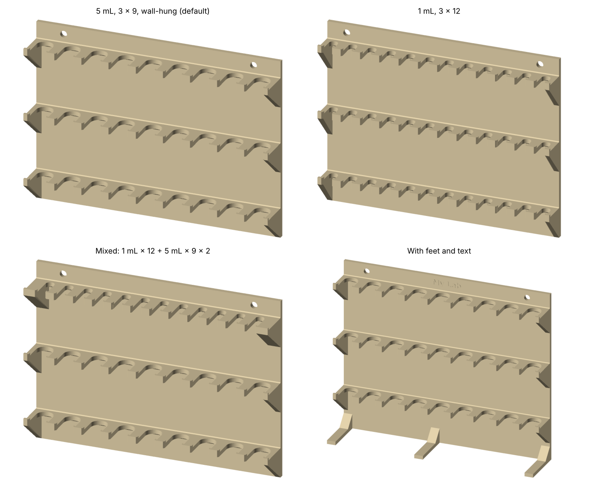

# Wall-Hung Column Rack

A parametric wall-hung rack for prepacked chromatography columns (Cytiva HiTrap-style 1 mL
and 5 mL), designed for FDM 3D printing. Each shelf has U-shaped slots that open to the front.
A column hangs in a slot, and a small lip on the front edge stops it from sliding out. The rack
hangs on two hooks (for example, magnetic hooks) through holes near the top of the back plate,
or, with optional feet, stands on a bench against a wall.

One Python script (`column_rack.py`) generates the rack. You can change the number of rows and
columns and the slot size, mix 1 mL and 5 mL rows, add feet, and emboss a label.

> **Status: untested.** The 5 mL slot geometry is taken from a rack that has been printed and used.
> The improvements listed below and the 1 mL slot (10.5 mm, from a measured 10 mm column OD)
> have only been checked numerically (closed manifold mesh, self-intersection checks, volume).
> Print one 1 mL row first to check the fit.



## Repository contents

| Path | Description |
|---|---|
| `column_rack.py` | Generator script (Python 3.8+, numpy; matplotlib only for text and previews) |
| `stl/column_rack_5mL_3x9.stl` | 5 mL, 3 rows × 9, wall-hung (default, 288 mm wide) |
| `stl/column_rack_5mL_3x8_256mm.stl` | 5 mL, 3 rows × 8, fits a 256 mm bed (`--width 256`) |
| `stl/column_rack_1mL_3x12.stl` | 1 mL, 3 rows × 12 (`--column 1`) |
| `stl/column_rack_1x12-5x9-5x9.stl` | Top row 1 mL × 12, two rows 5 mL × 9 (`--row-types 1,5,5`) |
| `images/preview.png` | Rendered preview |
| `LICENSE` | MIT License |
| `CITATION.cff` | Citation metadata (used by GitHub's "Cite this repository") |

## Generating a rack

```bash
pip install numpy matplotlib  # matplotlib is needed only for --text and --preview
python column_rack.py                                  # 5 mL, 3 rows x 9 -> column_rack_5mL_3x9.stl
python column_rack.py --rows 2 --cols 7                # any rows / columns
python column_rack.py --width 256                      # as many columns as fit in 256 mm (5 mL: 8, 1 mL: 11)
python column_rack.py --column 1                       # 1 mL rack (slot 10.5 mm, 12 per row)
python column_rack.py --row-types 1,5,5                # top row 1 mL, two rows 5 mL
python column_rack.py --set hook_slot=6                # hook holes as 14 x 8 mm slots
python column_rack.py --feet 2                         # with feet: stands on a bench against a wall
python column_rack.py --text "Iritani Lab"             # emboss text between the hook holes
python column_rack.py --list                           # all parameters; derived ones marked (auto)
python column_rack.py --preview rack.png               # also render a PNG preview
```

Any parameter can be changed with `--set KEY=VALUE` (lengths in mm). Lists are comma-separated
and given **top row first**.

### Main parameters

| Parameter | Default | Meaning |
|---|---|---|
| `column` / `row_types` | `5` / – | Column type for all rows, or per row (`1,5,5`) |
| `rows`, `cols` | 3, auto | Shelves and slots per shelf. By default `cols` is as many as fit in `width` (5 mL: 9, 1 mL: 12). A single number applies to the widest-pitch rows and the others are filled to the same width; or give one per row |
| `width` | 288 | Target width for the automatic column count (288 mm = the original rack; 256 for a 256 mm bed) |
| `row_pitch` | 78 | Vertical distance between shelves (one value, or one per gap) |
| `slot_w_5`, `slot_w_1` | 20, 10.5 | U-slot width per column type |
| `pitch_5`, `pitch_1` | auto | Slot pitch (auto: `slot_w` + `finger_w`, 12 mm) |
| `front_run`, `back_gap` | 13, 5 | Straight part of the slot from the front edge; shelf left behind the slot |
| `lip_h`, `lip_d` | 3, 3 | Retaining lip on the front edge of each finger (0 = none) |
| `mouth_chamfer` | 1.5 | 45° lead-in at the slot mouth |
| `brace`, `top_chamfer` | 3, 1 | 45° chamfers under and on top of each shelf where it meets the plate |
| `gussets`, `gusset_h` | `ends`, 30 | Triangular braces under the shelf ends (`ends`, `all`, `none`) |
| `plate_t`, `plate_above`, `plate_below` | 5, 20, auto | Back plate thickness and extent |
| `hook_n`, `hook_d`, `hook_slot` | 2, 8, 0 | Hook holes: number, diameter, extra horizontal length |
| `hook_inset`, `hook_from_top` | auto, 10 | Hole position from the plate end / top edge |
| `feet` | 0 | Number of feet (0 = wall-hung only). See below |
| `foot_w`, `foot_t`, `foot_ext`, `foot_brace` | 12, 5, 20, 15 | Foot width, thickness, reach in front of the shelves, 45° brace size |
| `foot_clear` | auto | With feet: free height under the lowest shelf (auto: `col_below` + 5 mm, else 50 mm) |
| `text`, `text_size`, `text_h`, `text_z`, `text_font` | –, auto, 0.6, auto, DejaVu Sans:bold | Embossed text between the hook holes (see below) |
| `bed_x`, `bed_y` | 256, 256 | Printer bed, for the fit check |

Optional values for the checks: `col_mass` (g per column, for the load estimate), `shoulder_d`
(diameter of the part of the column that rests on the shelf), `col_above` / `col_below` (how
far a hanging column sticks up above the shelf / hangs below it).

### Output and checks

```
column_rack_5mL_3x9.stl: 16652 triangles, volume 411.5 cm3 (~510 g solid at 1.24 g/cm3)
  size 288.0 (W) x 43.0 (D) x 211.0 (H) mm; closed manifold: True, zero-area triangles: 0, cross-sections simple: True
  row 1 (top first): 9 x 5 mL, slot 20 mm, pitch 32 mm, slot centre 23.0 mm behind the front edge, shelf top z=191.0
  ...
  hook holes: 2 x Ø8 mm at x = 32.0, 256.0 (spacing 224.0 mm), 10 mm below the top
  print footprint 288 x 211 mm on its back: WARNING: does not fit a 256 x 256 mm bed
```

The script stops with an explanation if the parameters cannot give a valid rack (for example,
rows too close for the gussets, or a chamfer larger than the shelf behind the slot). With the
optional column dimensions it also warns if neighbouring columns touch, if a column hits the
plate, or if there is not enough room to lift a column over the lip.

## Text (optional)

`--text` embosses a label on the front of the back plate, at the top, between the two hook
holes. It needs matplotlib for the font outlines.

```bash
python column_rack.py --text "Smith Lab John Doe"
python column_rack.py --text "第一実験室　山田太郎" --set "text_font=Yu Gothic:bold"     # Japanese (Windows)
```

- **Size.** By default the text is up to 10 mm, made smaller automatically if it is too long for
  the space between the holes. Set it with `text_size` (mm). 4 mm or more with a bold font prints
  cleanly with a 0.4 mm nozzle.
- **Position.** Level with the hook holes. Change it with `text_z`.
- **Raised, not engraved.** The letters stand 0.6 mm proud (`text_h`). They are separate
  closed shells sunk 0.4 mm into the plate, which slicers merge automatically. The rack is
  printed on its back, so the letters face up and need no support.
- **Fonts.** The default is DejaVu Sans Bold (ships with matplotlib, Latin only). For Japanese,
  use an installed font: `Yu Gothic:bold` or `Meiryo:bold` (Windows), `Hiragino Sans` (macOS),
  `Noto Sans CJK JP:bold` (Linux). The script stops if the font is missing or lacks a character,
  instead of printing empty boxes.
- **Checks.** It warns if the text runs into the hook holes, does not fit between the top shelf
  and the top edge, or is smaller than 4 mm.

## Standing against a wall (feet)

With `--feet N` the rack stands on a bench with its back against a wall, instead of hanging.
Each foot is a bar running forward from the bottom of the plate, with a 45° brace. The outer
feet are flush with the plate ends. Inner feet are placed under a finger between two slots,
so no column hangs directly above them. The hook holes are kept (set `hook_n=0` to remove them).

```bash
python column_rack.py --feet 2                              # 2 feet at the ends
python column_rack.py --feet 3 --set col_below=60           # 3 feet; shelf raised for 60 mm columns
python column_rack.py --feet 1 --set foot_w=288             # one full-width base (catches drips)
```

- **Height.** The lowest shelf is raised so the bottom row of columns clears the table and the
  feet. The default is 50 mm of free space. Give `col_below` (how far a column hangs below the
  shelf) or set `foot_clear` directly.
- **Stability.** The script prints where the centre of mass is, measured from the front of the
  feet. The wall stops the rack tipping backwards. The feet stop it tipping forwards when you
  pull a column out. For a tall rack, a strip of double-sided tape under the feet helps.
- **Printing.** Still printed lying on its back with no supports: the feet become vertical fins.
  The rack gets taller, so check the bed size (`--width 256 --feet 2` is 256 × 236 mm).

## 1 mL columns

The 1 mL slot is 10.5 mm wide: the column's measured outer diameter (10 mm) plus 0.5 mm
clearance. If your printer prints holes undersize, increase it with `--set slot_w_1=10.8`.
The pitch is 22.5 mm (slot + 12 mm finger), so by default (`width` 288 mm) a row holds 12 columns
(270 mm). On a 256 mm bed use `--width 256` (11 columns, 248 mm).

## Changes from the original SketchUp model

`--set mouth_chamfer=0 --set brace=0 --set top_chamfer=0` reproduces the original geometry
(3 × 9 slots, 288 × 43 × 211 mm). The defaults add:

- **45° lead-in at each slot mouth**, so a column slides in more easily.
- **Chamfers where the shelves meet the plate**, which remove the sharp inside corners where
  cracks start.
- **Optional slotted hook holes** (`hook_slot`). Two hooks placed by hand are never exactly
  224 mm apart. Slots allow for that.
- **A single closed mesh.** The original STL has overlapping internal shells. This one is a
  single closed surface.

## Printing

| Setting | Recommendation |
|---|---|
| Orientation | Lying on its back (back face on the bed). No supports needed. |
| Bed size | The default 5 mL rack is 288 mm wide. On a 256 mm bed use `--width 256` (5 mL: 8 columns, exactly 256 mm, no brim) |
| Material | PETG or PLA |
| Walls / infill | 3–4 perimeters, 15–20 % infill. The plate is most of the mass |

## Author

Yu Iritani — Department of Chemistry, Graduate School of Science, The University of Osaka

The 5 mL slot geometry comes from the author's earlier rack, drawn in SketchUp and used in the lab.

## License

Released under the [MIT License](LICENSE). This covers the script, the STL files and the
images. You may use, modify and share them, including in your own designs, provided the
copyright notice is kept.

"Cytiva" and "HiTrap" are trademarks of Global Life Sciences Solutions USA LLC or an affiliate
doing business as Cytiva. This project is not affiliated with or endorsed by Cytiva. The names are
used here only to identify the columns the rack was designed for.

## Citation

If this rack is useful in your work, please cite this repository. GitHub's
**"Cite this repository"** button (right sidebar) gives the reference in APA and BibTeX format.

> Iritani, Y. (2026). *Wall-Hung Column Rack* (version 1.0).
> https://github.com/yakamasiinen/column-rack
